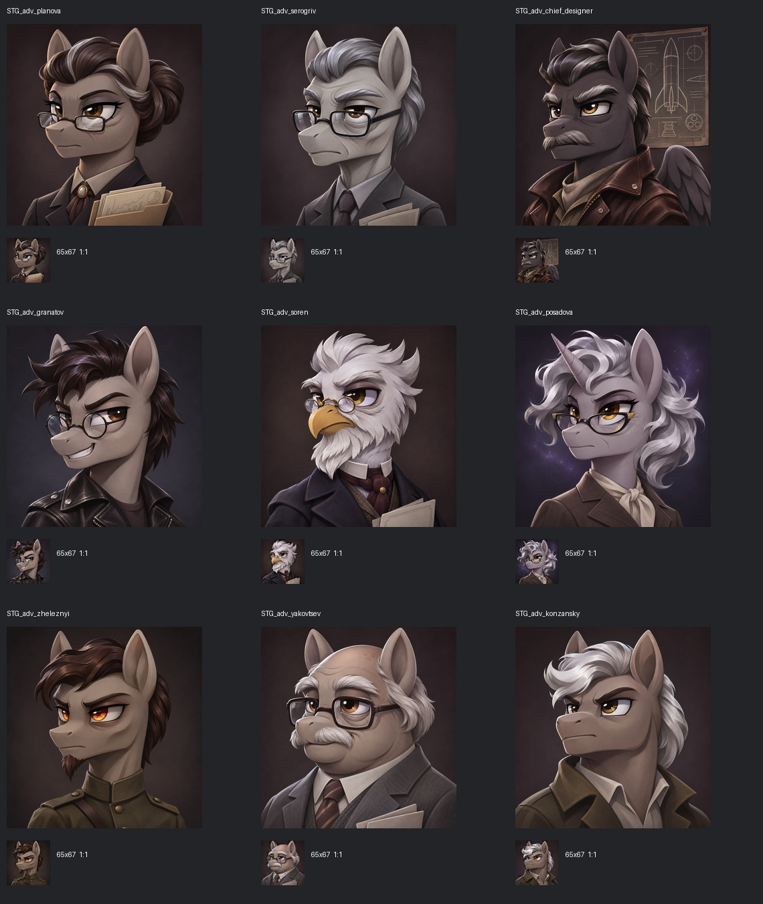

# Stalliongrad Rework — арт второй очереди

Графика для сабмода Equestria at War (HOI4), страна Сталлионград.

## Готовность: 18 / 101 игровых файлов

- Пачка 01: **7 портретов лидеров и 2 версии советников** (приоритет A).
- Пачка 02: **9 новых портретов советников** (приоритет A).

Остальные **83 файла ещё не созданы**.

[Пачка 01](art/wave2/batch01/) · [Пачка 02](art/wave2/batch02/) · [Техническое задание](art/wave2/batch01/art_spec_wave2.md)

[Полный список арта и статусы](progress.json)

## Содержимое пачек

- `game/` — игровые DDS BC3/DXT5 с альфа-каналом, без мипмапов.
- `masters/` — PNG: лидеры 780×1050, советники 650×670.
- `preview_*.jpg` — обзорные листы с игровыми размерами 1:1.
- `manifest.json` — имена, размеры, пути и SHA-256 игровых файлов.
- `prompts.json` — точные промпты image_gen и сведения о преобразовании.
- `README.txt` — краткая инструкция.

Для установки скопируйте содержимое `game/` из каждой нужной пачки в папку мода. Регистрация спрайтов не включена — её выполняет отдельный скрипт проекта.

Портреты созданы встроенным image_gen. Darkwing из EaW использован как ориентир стиля; персонажи оригинальные. Версии советников Любимова и Кржинского получены кадрированием соответствующих портретов лидеров.
